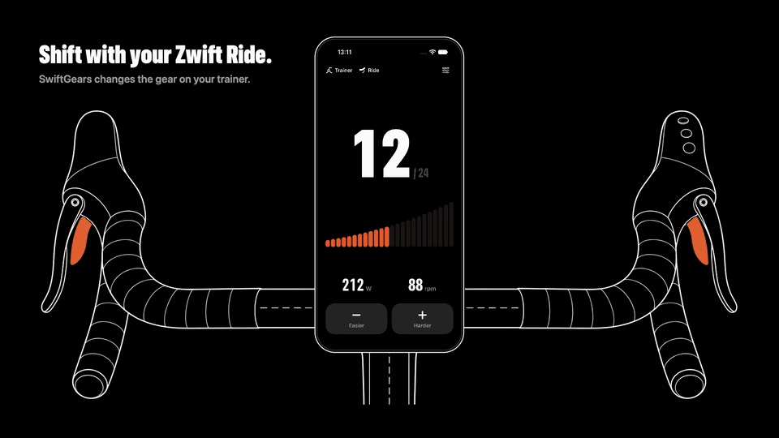
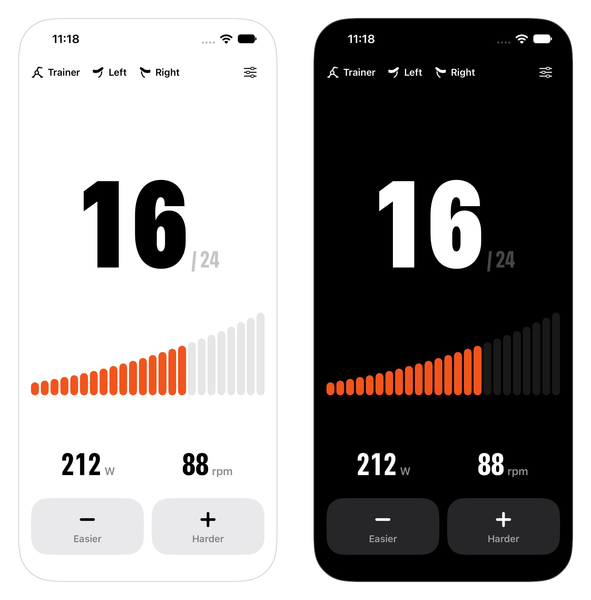

<picture>
  <source media="(prefers-color-scheme: dark)" srcset="docs/header-dark.png">
  
</picture>

Virtual shifting on your trainer without the Zwift app. Shift with the Zwift Ride handlebars and your
Wahoo KICKR CORE changes resistance, while you ride in whatever training app you like.

<p align="center">
  
</p>

## What it does

- **Shifts like Zwift.** The left shifters make it easier, the right shifters harder, through Zwift's own
  24 gear ratios. The trainer works out the resistance itself, just as it does in Zwift.
- **Stays out of the way.** It keeps shifting in the background, so your training app can stay in front.
- **Shows your gear at a glance.** A big gear number, the gear ramp, power and cadence. Drag across the
  ramp to jump to a gear.
- **No account, no tracking.** It connects to your trainer and handlebars, and nothing else.

<p align="center">
  
</p>

## What you need

- An iPhone with iOS 17 or later
- A **Wahoo KICKR CORE with the Zwift Cog** (the Zwift One version), updated in the Wahoo app
- **Zwift Ride** handlebars. A Ride on firmware 1.3 or later has to be unlocked in Zwift once a day.

Let your training app only *read* power and cadence from the trainer. If it also sets the resistance (ERG
workouts or simulated hills), the two apps fight over the trainer.

## Build it

```sh
brew install xcodegen
xcodegen                      # creates SwiftGears.xcodeproj
open SwiftGears.xcodeproj
```

Choose your own team under **Signing & Capabilities** and run it on your iPhone. The simulator has no
Bluetooth, so launch it there with the `-demo` argument to see a connected ride.

The protocol code is a Swift package with tests that run on your Mac:

```sh
swift test
```

## How it works

The trainer and the Ride speak the same Bluetooth protocol: an opcode byte followed by a protobuf message.
SwiftGears sends the trainer the gear message Zwift sends (gear ratio, bike and rider weight, on a flat road)
and reads the button presses from the Ride (its left half reports the buttons of both).

| Where | What |
| --- | --- |
| [`Sources/GearsCore`](Sources/GearsCore) | The protocol, without any UI or Bluetooth: [messages](Sources/GearsCore/Zwift.swift), [gears](Sources/GearsCore/Gearbox.swift), [shifter buttons](Sources/GearsCore/ShiftDetector.swift) and [device recognition](Sources/GearsCore/DeviceRole.swift). Fully tested. |
| [`App/Bluetooth`](App/Bluetooth) | [`ZwiftCentral`](App/Bluetooth/ZwiftCentral.swift) finds, connects and talks to the trainer and the Ride. |
| [`App/Model`](App/Model) | [`RideModel`](App/Model/RideModel.swift) holds the ride state and turns shifts into gear messages. |
| [`App/Views`](App/Views) | The SwiftUI screens. |

The protocol was reverse engineered by others first. Thanks to:

- [Makinolo](https://www.makinolo.com/blog/2024/10/20/zwift-trainer-protocol/) for the Zwift Ride and trainer protocol write-ups
- [SHIFTR](https://github.com/JuergenLeber/SHIFTR) for the gear ratios and message layout
- [BikeControl](https://github.com/OpenBikeControl/bikecontrol) for the Ride button map

## Disclaimer

SwiftGears is not affiliated with, endorsed by or connected to Zwift, Inc. or Wahoo Fitness. Zwift, Zwift
Ride, Zwift Cog, KICKR and KICKR CORE are trademarks of their owners. Zwift can change the protocol with a
firmware update at any time.

## License

[MIT](LICENSE)
